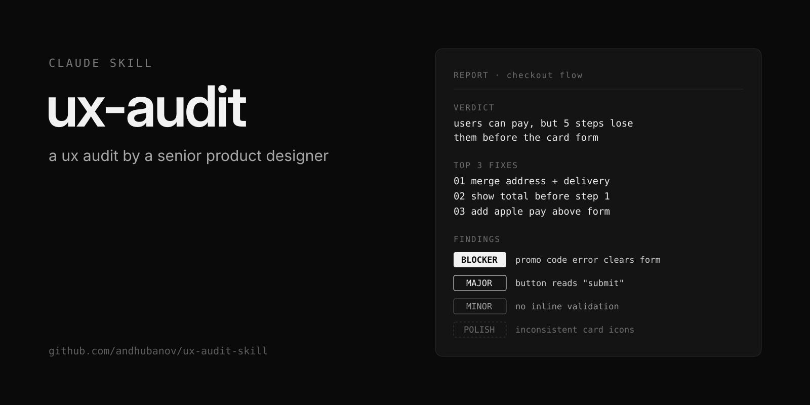

# ux-audit-skill

[](https://github.com/andhubanov/ux-audit-skill/actions/workflows/check.yml)



A skill for Claude that runs a structured UX audit. Give it a screenshot, a URL, a Figma link or a description of a flow. It returns a short verdict, the three fixes that matter most, and ranked findings with concrete changes.

## What you get

- a verdict on whether the user can reach the primary goal
- the top three fixes by impact and effort
- findings ranked as blocker, major, minor and polish, each with the problem, why it matters and the fix
- what already works, and what the audit could not judge

## Example

Full sample reports:

- [checkout flow audit](examples/checkout-flow.md) · mobile checkout, goal: completed payments
- [onboarding audit](examples/onboarding.md) · budgeting app, goal: first budget created

## Install

Claude Code: copy the `ux-audit` folder into `~/.claude/skills/`.

```bash
git clone https://github.com/andhubanov/ux-audit-skill.git
cp -r ux-audit-skill/ux-audit ~/.claude/skills/
```

Other Claude apps with skills support: upload the `ux-audit` folder as a skill.

## Use

Ask in plain language:

- "audit this onboarding" and attach screenshots
- "review the signup flow at https://example.com for usability"
- "ux audit of this pricing page, goal is trial starts"

## What it checks

Clarity of purpose, hierarchy, navigation, forms, states and feedback, copy, consistency, trust and friction, mobile, accessibility basics, and growth hooks when conversion matters.

## License

MIT

---

made by [@AndriiDsgn](https://x.com/AndriiDsgn) · [hubanov.space](https://hubanov.space/)
